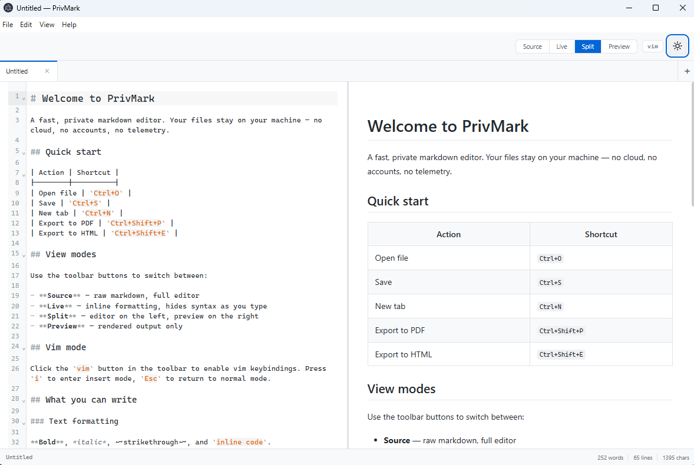
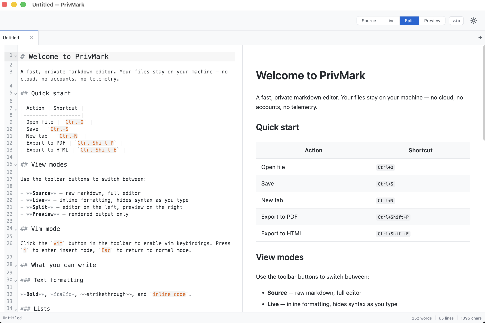
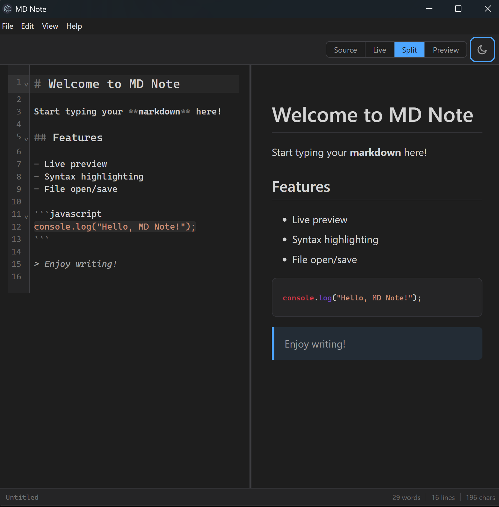
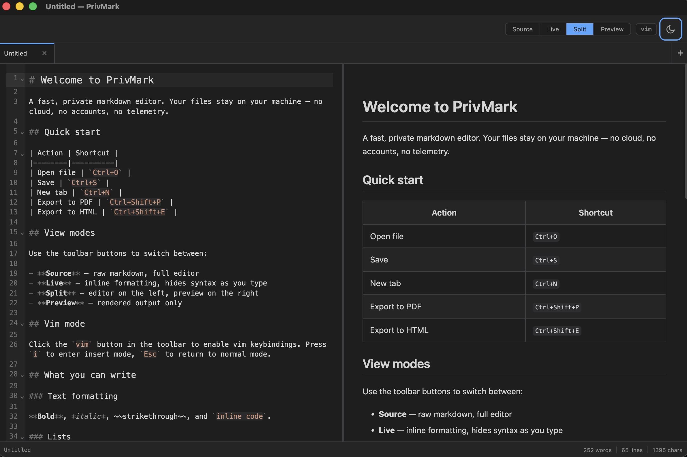

# PrivMark

**A fast, beautiful markdown editor with dark mode and live preview.**

The markdown editor for writers who care about speed, privacy, and beautiful design.

**macOS:**

---

## Features

**Write markdown. See it rendered. Instantly.**

- **Split-pane editing** — raw markdown on the left, live preview on the right
- **Four view modes** — Source, Live, Split, and Preview
- **Dark mode** — one-click toggle, remembers your preference, matches your system
- **Syntax highlighting** — 180+ languages via highlight.js
- **Custom editor theme** — CodeMirror 6 with matched light and dark themes
- **Status bar** — live word count, line count, character count, reading time
- **Native file dialogs** — open and save `.md` files like a real desktop app
- **Export** — HTML, PDF, and Word (`.docx`); `Ctrl+Shift+E` / `Ctrl+Shift+P`
- **Document themes** — 12 presets (GitHub, Newsprint, Solarized, Dracula, …) that restyle preview and exports
- **Focus & typewriter modes** — dim everything but the current paragraph, keep your line centered
- **Vim keybindings** — opt-in toggle in the toolbar
- **File tree sidebar** — open a folder, browse and switch files
- **Outline panel** — heading tree with click-to-jump navigation
- **Quick Open** — `Ctrl+T` fuzzy file finder
- **Open Recent** — File → Open Recent lists your last 10 files and folders
- **Font size shortcuts** — `Ctrl+=`/`Ctrl+-` or `Ctrl+Scroll` to adjust document font size
- **File change detection** — offers to reload (or keep yours) when a file changes on disk (e.g., git checkout)
- **Explorer integration** — right-click a folder → "Open in PrivMark" (Windows)
- **GFM support** — strikethrough, tables, task lists, auto-linking, footnotes, and `> [!NOTE]` alerts
- **Local images** — `` next to your document renders, and is embedded in HTML/PDF exports
- **LaTeX math** — inline `$x$` and block `$$x$$` via KaTeX
- **Mermaid diagrams** — fenced code blocks rendered as diagrams
- **Slide decks** — `marp: true` in front matter turns a document into Marp-compatible slides; PDF export gives one slide per page
- **Extended syntax** — definition lists, `*[ABBR]: …` abbreviations, `++inserted++` text, and `:emoji:` shortcodes
- **Find & Replace** — `Ctrl+F` / `Ctrl+H` with regex support
- **Local AI (Pro)** — rewrite, summarize, title, and custom prompts via [Ollama](https://ollama.com), entirely on your machine
- **Terminal & CLI** — `privmark .` opens a folder like `code .`; `privmark render`, `outline`, `rewrite`, `summarize` and more for scripts and AI agents
- **Auto-update** — new versions delivered automatically on Windows and macOS
- **Cross-platform** — Windows (x64, ARM64), macOS (Intel, Apple Silicon), and Linux (x64, ARM64)

**macOS dark mode:**

---

## Install

### VS Code Extension

Install from the [Visual Studio Marketplace](https://marketplace.visualstudio.com/items?itemName=Wolfberry.privmark-markdown-editor) or search "PrivMark" in the Extensions panel (`Ctrl+Shift+X`).

### Windows

| Installer | Description |
|-----------|-------------|
| [**PrivMark-Setup-&lt;version&gt;-x64.exe**](https://github.com/wolfberry-ab/privmark/releases/latest) | Recommended — wizard installer with desktop shortcut (Intel/AMD) |
| [**PrivMark-Setup-&lt;version&gt;-arm64.exe**](https://github.com/wolfberry-ab/privmark/releases/latest) | Wizard installer for ARM64 |
| [**PrivMark-win32-x64-&lt;version&gt;.zip**](https://github.com/wolfberry-ab/privmark/releases/latest) | Portable — no installation needed (Intel/AMD) |

### Linux

| Package | Description |
|---------|-------------|
| [**PrivMark-linux-x64-&lt;version&gt;.zip**](https://github.com/wolfberry-ab/privmark/releases/latest) | x64 (Intel/AMD) |
| [**PrivMark-linux-arm64-&lt;version&gt;.zip**](https://github.com/wolfberry-ab/privmark/releases/latest) | ARM64 (Raspberry Pi 4+) |
| [**.deb / .rpm**](https://github.com/wolfberry-ab/privmark/releases/latest) | Native packages for Debian/Ubuntu and Fedora/RHEL |

### macOS

| Package | Description |
|---------|-------------|
| [**PrivMark-darwin-x64-&lt;version&gt;.dmg**](https://github.com/wolfberry-ab/privmark/releases/latest) | Intel Mac |
| [**PrivMark-darwin-arm64-&lt;version&gt;.dmg**](https://github.com/wolfberry-ab/privmark/releases/latest) | Apple Silicon (M1/M2/M3/M4) |

> macOS builds are signed with our Apple Developer ID and notarized by Apple.

> All releases include SHA256 checksums. [Verify your download](https://github.com/wolfberry-ab/privmark/releases/latest).

---

## Why PrivMark?

| | PrivMark |
|---|---|
| **Price** | **Free forever** (optional $9 one-time Pro upgrade for local AI — 14-day trial now, purchases open soon) |
| **Works offline** | Always — no account, no cloud, no internet required |
| **Dark mode** | Built-in with one-click toggle |
| **Split pane** | Source + preview side by side |
| **Real markdown files** | Your files, plain `.md`, no proprietary format |
| **AI writing (Pro)** | Built-in, runs on local models via Ollama for full privacy |
| **Privacy** | No analytics, no tracking. Update checks via GitHub may expose your IP to GitHub's CDN |
| **Auto-update** | New versions delivered seamlessly |
| **Active development** | Regular updates, public changelog |

---

## Local AI (Pro)

**AI-assisted writing** — built into the editor, running on your own machine via [Ollama](https://ollama.com).

- **Rewrite selection** — simplify, shorten, expand, or shift tone (professional or casual)
- **Summarize** — a short TL;DR for any document or folder
- **Generate titles** — short, descriptive titles based on the content
- **Custom instructions** — any free-form prompt via the AI panel (`Ctrl+Shift+A`) or the AI bubble
- **Streaming rewrites** — text transforms live in the editor, with Keep / Revert

> The editor is free forever. PrivMark Pro unlocks local AI — $9 one-time. The 14-day free trial is available now; purchases open soon. A license is a signed file that works fully offline and covers every PrivMark 1.x release.

---

## Privacy & Security

PrivMark is built by [Wolfberry AB](https://wolfberry.se), a security-focused Swedish software company.

- **No telemetry** — no analytics, no tracking, no data collection
- **No account required** — download, install, write
- **No cloud dependency** — everything runs locally on your machine
- **Local AI** — AI features run on local models (Ollama); your text never leaves your computer
- **Offline licensing** — a Pro license is a signed file verified on your device; no activation server
- **Your files, your machine** — we never see your documents

---

## Tech Stack

Built with modern, proven technology:

- **Electron 40** — native desktop performance
- **React 19** — fast, responsive UI
- **CodeMirror 6** — the best code editor component
- **markdown-it** — fast, spec-compliant markdown parsing
- **highlight.js** — syntax highlighting for 180+ languages

---

## Changelog

See [Releases](https://github.com/wolfberry-ab/privmark/releases) for the full changelog.

---

## Feedback & Support

- **Bug reports:** [Open an issue](https://github.com/wolfberry-ab/privmark/issues)
- **Feature requests:** [Open an issue](https://github.com/wolfberry-ab/privmark/issues)
- **Email:** hello@privmark.app

---

Made with care by [Wolfberry AB](https://wolfberry.se) in Sweden.

Copyright 2026 Wolfberry AB. All rights reserved.

